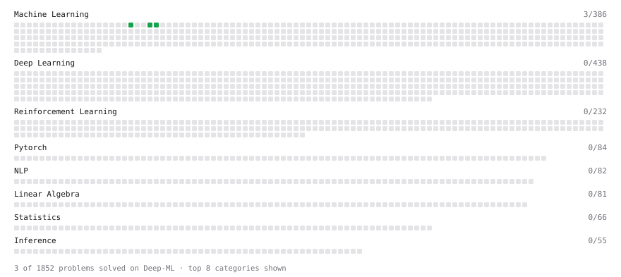

# Deep-ML

My machine learning practice from [Deep-ML](https://www.deep-ml.com). Every solution here was written by hand.

**2** solved · 2 problems · 0 labs · 0 math

[**Browse the interactive portfolio**](https://Sandeep-reddy-2811.github.io/deep-ml/) to replay this filling in over time.

## Problems

| | Difficulty | Solved | |
| --- | --- | --- | --- |
| [Implement Precision Metric](https://www.deep-ml.com/problems/46) | easy | 2026-10-15 | [solution](problems/0046-implement-precision-metric) |
| [Implement Recall Metric in Binary Classification](https://www.deep-ml.com/problems/52) | easy | 2026-10-15 | [solution](problems/0052-implement-recall-metric-in-binary-classification) |

---

_This file is regenerated by Deep-ML on every push._
